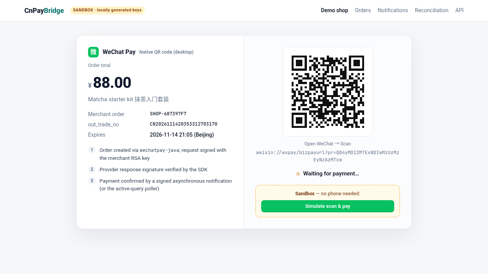
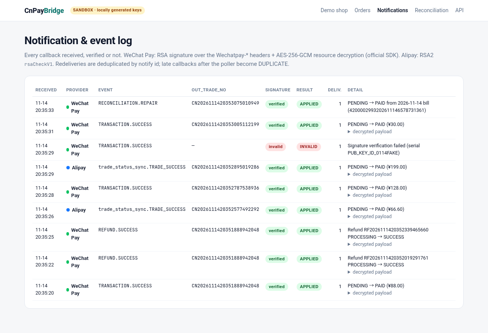
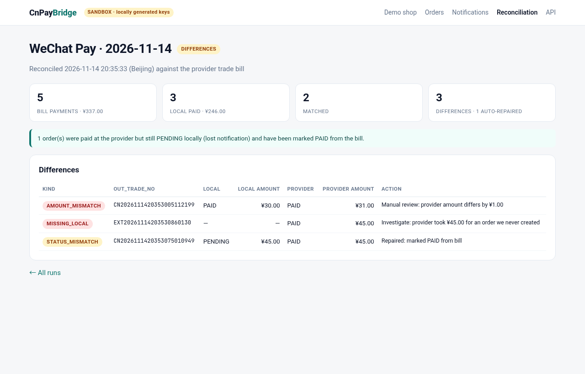
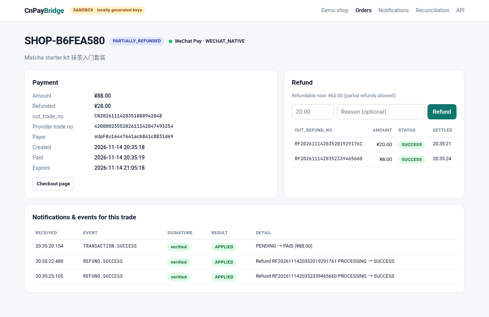
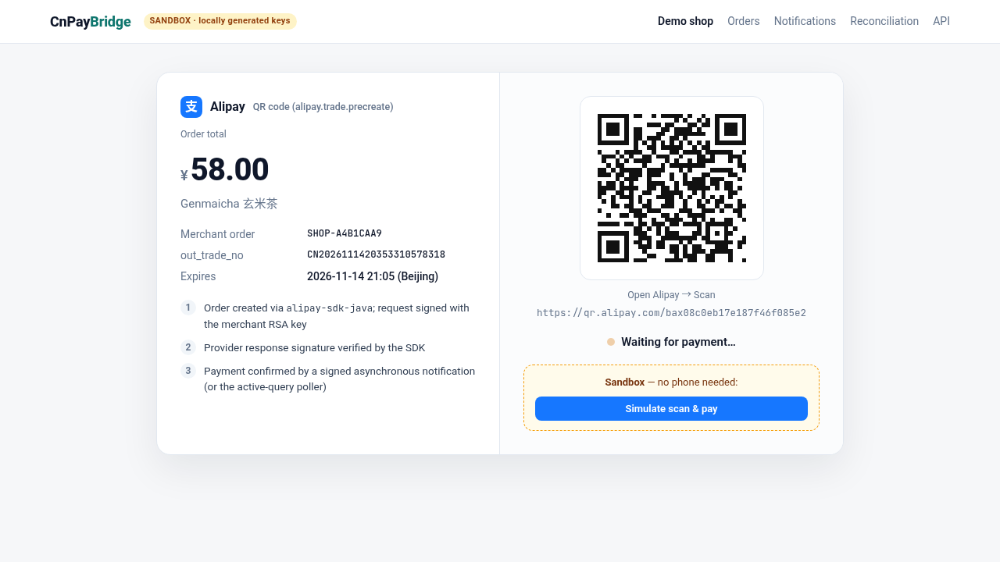
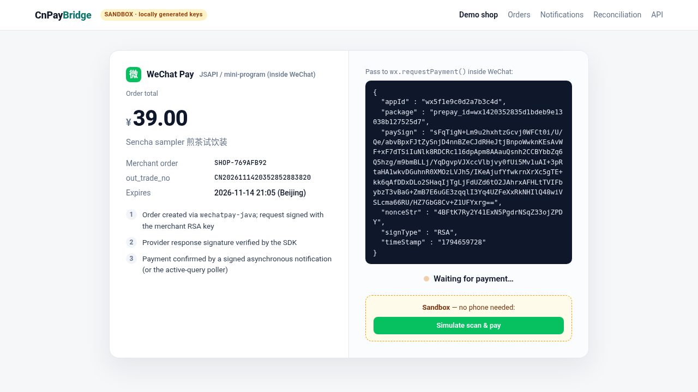
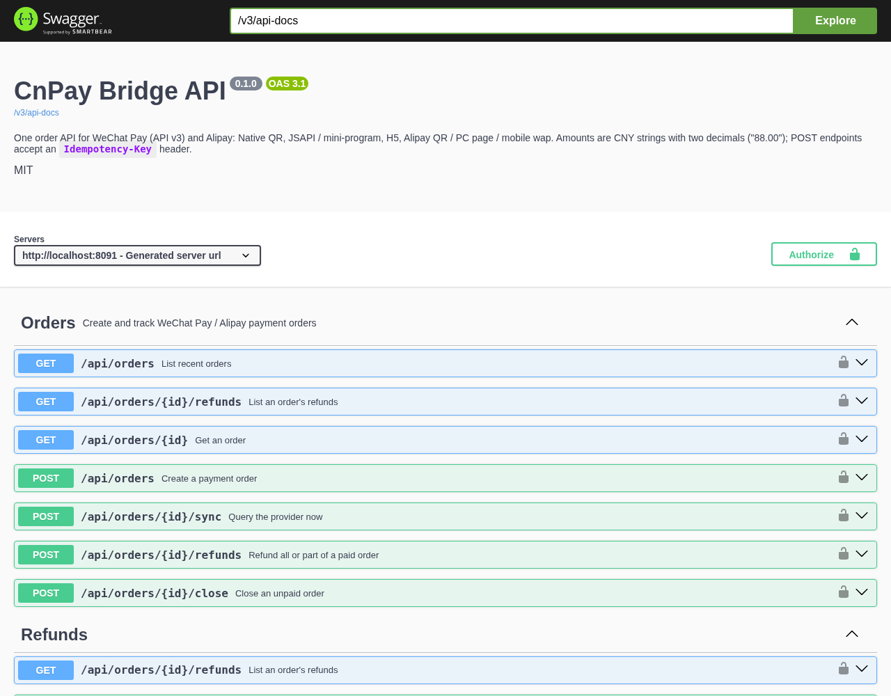
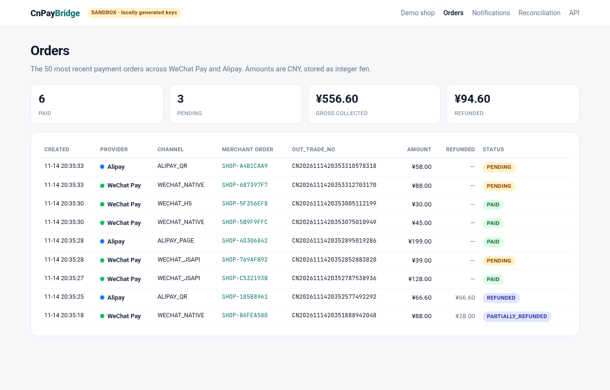
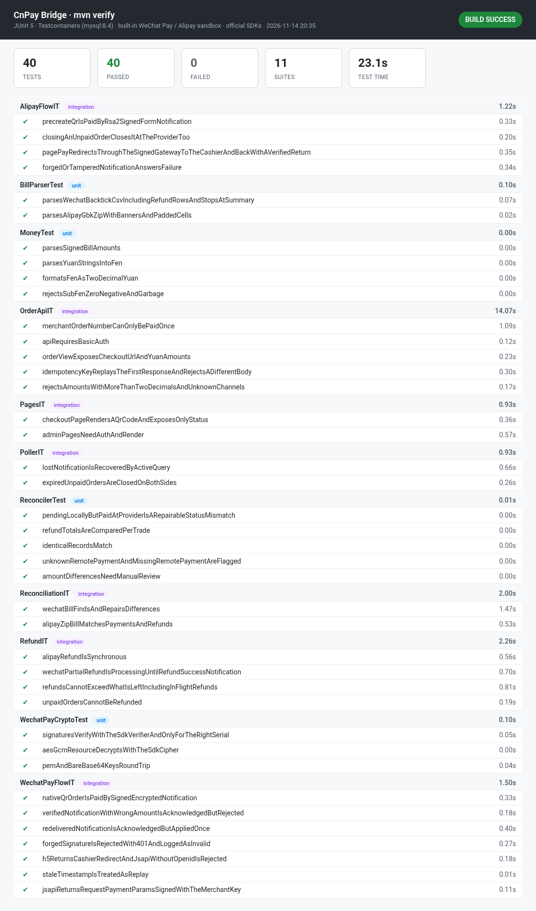

# CnPay Bridge: WeChat Pay (API v3) + Alipay backend for merchants selling into China

[](https://github.com/solace202/cnpay-bridge/actions/workflows/ci.yml)


CnPay Bridge gives an overseas shop **one order API for WeChat Pay and Alipay**. It covers Native QR codes,
JSAPI / mini-program, H5 for mobile browsers, and the Alipay QR, PC and mobile cashiers. It also does the parts
that usually go wrong: **signed asynchronous notifications** (WeChat Pay v3 AES-256-GCM resources, Alipay RSA2
forms), **idempotency**, **partial refunds**, an **active-query poller** for lost callbacks, and a
**daily reconciliation job** (对账) that downloads the providers' bills and repairs or flags differences.

Provider calls use the **official SDKs**:
[`wechatpay-java`](https://github.com/wechatpay-apiv3/wechatpay-java) and
[`alipay-sdk-java`](https://github.com/alipay/alipay-sdk-java-all). You don't need a merchant account to try it. A
**built-in sandbox** plays both providers over real HTTP with **locally generated RSA keys**:

- it verifies the merchant's request signatures;
- it signs every response, which the SDKs verify;
- it encrypts and signs callbacks;
- it serves daily bills in the real file formats.

Going live is a configuration change.



## Features

- **Unified order API.** `POST /api/orders` with `channel` set to one of:
  - `WECHAT_NATIVE`
  - `WECHAT_JSAPI`
  - `WECHAT_H5`
  - `ALIPAY_QR`
  - `ALIPAY_PAGE`
  - `ALIPAY_WAP`

  The response holds what the client needs:
  - a QR payload (`weixin://wxpay/bizpayurl?…`, `https://qr.alipay.com/…`);
  - the signed `wx.requestPayment` parameters (`appId/timeStamp/nonceStr/package/signType/paySign`);
  - or a cashier redirect.

  The checkout page renders the QR code (ZXing) and polls the order status.
- **CNY done right.** Amounts are integer **fen** (`BIGINT`). The API accepts `"88.00"` and rejects a third
  decimal place. WeChat Pay gets `amount.total = 8800` and Alipay gets `total_amount = "88.00"`. Bills are parsed
  back to fen. All timestamps use Beijing time, matching `time_expire`, `gmt_payment` and the bill dates.
- **Notifications, verified then applied:**
  - **WeChat Pay v3.** `Wechatpay-Signature` is checked against the platform public key (`PUB_KEY_ID_…`) with a
    5-minute timestamp window. The `encrypt-resource` is decrypted with the APIv3 key (AEAD_AES_256_GCM). Both
    steps go through the SDK's `NotificationParser`.
  - **Alipay.** `rsaCheckV1` with the Alipay public key. The handler answers `success`, or `failure` so that
    Alipay retries.
  - Before anything changes, the handler cross-checks `mchid`/`appid`/`app_id`, `out_trade_no`, the **amount** and
    the currency against the order.
  - Every callback lands in an **event log**, including invalid ones. It is deduplicated on
    `(provider, notify_id)` in the same transaction as the state change. The state change itself is a
    conditional `UPDATE … WHERE status='PENDING'`, so a redelivery or a callback that loses a race with the
    poller becomes a harmless `DUPLICATE`.
- **Idempotency.** `Idempotency-Key` on order and refund creation:
  - same key and same body → the first response is replayed;
  - same key and a different body → `422`.

  A merchant order number can have only one payment order (`409`).
- **Refunds.** Partial or full:
  - Refunds are reserved under a **row lock** on the order, so concurrent refunds can't exceed the paid amount,
    in-flight refunds included.
  - WeChat Pay refunds are `PROCESSING` until the `REFUND.SUCCESS` callback arrives. Alipay refunds are
    synchronous; a retried `out_request_no` returns `fund_change=N`, which still counts as success.
  - The order moves to `PARTIALLY_REFUNDED`, then `REFUNDED`.
- **Lost-callback safety net.** A scheduled poller queries `PENDING` orders and marks them paid if the provider
  says so. It also closes expired orders **at the provider first**, so a late scan can't succeed.
- **Reconciliation (对账).** Runs nightly at 10:30 Beijing time for the previous day, or on demand:
  - Downloads the **WeChat Pay trade bill** (back-tick CSV, SHA-1 digest verified) and the **Alipay bill** (zip
    with a GBK CSV and `#` banner lines). Columns are found by header name.
  - Compares the bill with local orders and refunds:
    - `STATUS_MISMATCH` is **auto-repaired** (the notification was lost);
    - `MISSING_LOCAL`, `MISSING_REMOTE`, `AMOUNT_MISMATCH` and `REFUND_MISMATCH` are recorded for review.
- **Sandbox fault injection.** From the admin UI you can:
  - drop the next notification;
  - create a payment the merchant never created;
  - tamper with a provider-side amount.

  Each one shows what the poller and the reconciliation catch.
- **Ops:**
  - Flyway (MySQL 8);
  - springdoc **Swagger UI**;
  - RFC 9457 problem responses with a stable `code`;
  - HTTP Basic on `/api` and `/admin`;
  - Actuator probes;
  - multi-stage Docker image, Docker Compose and GitHub Actions.
- **Tests.** 40 unit and integration tests on **MySQL 8.4 (Testcontainers)**. They run the official SDKs
  against the sandbox over HTTP and cover:
  - forged, replayed and tampered callbacks;
  - amount mismatches and duplicate deliveries;
  - idempotency conflicts and over-refunds;
  - lost notifications, expiry and reconciliation;
  - crypto cross-checks of the sandbox against the SDKs' own verifier and cipher.

## Architecture

```mermaid
flowchart LR
    subgraph Shop
      FE[Web / mini-program / app]
      BE[Your backend]
    end
    subgraph Bridge[CnPay Bridge]
      API[/api/orders, refunds/]
      PAY[/pay/{id} checkout/]
      NOTIFY[/notify/wechat, /notify/alipay/]
      SVC[Order + refund services<br/>idempotency, row locks]
      POLL[Pending-order poller]
      RECON[Reconciliation job]
      DB[(MySQL 8<br/>orders, refunds, payment_events,<br/>idempotency_keys, reconciliations)]
    end
    subgraph Providers[WeChat Pay API v3 / Alipay OpenAPI<br/>or the built-in sandbox]
      WX[api.mch.weixin.qq.com]
      ALI[openapi.alipay.com/gateway.do]
    end
    BE -->|Basic auth + Idempotency-Key| API --> SVC
    FE --> PAY
    SVC -->|wechatpay-java / alipay-sdk-java<br/>signed requests, verified responses| WX & ALI
    WX & ALI -->|signed callbacks| NOTIFY --> SVC
    POLL -->|query / close| WX & ALI
    RECON -->|download bill| WX & ALI
    SVC --> DB
```

A payment from the shopper's side:

1. The shop backend calls `POST /api/orders`. CnPay Bridge stores the order as `PENDING` with an
   `out_trade_no`, then calls the provider through the official SDK.
2. The shopper scans the QR code, pays inside WeChat, or goes through the Alipay cashier.
3. The provider posts a signed notification. The bridge verifies it, decrypts it and checks the amount, then
   moves the order to `PAID`.
4. If the notification never arrives, the poller's active query or the next day's reconciliation settles the
   order.

## Quick start (sandbox, no accounts needed)

```bash
docker compose up -d --build            # MySQL 8.4 + the app on :8091
open http://localhost:8091              # demo shop → pick a channel → "Simulate scan & pay"
open http://localhost:8091/admin        # admin / change-me: orders, notifications, reconciliation
open http://localhost:8091/swagger-ui.html
```

Or drive the API directly:

```bash
curl -su admin:change-me -X POST localhost:8091/api/orders \
  -H 'Content-Type: application/json' -H "Idempotency-Key: $(uuidgen)" \
  -d '{"merchantOrderNo":"SHOP-1001","channel":"WECHAT_NATIVE","amount":"88.00","description":"Matcha starter kit"}'
# → 201 {"status":"PENDING","payment":{"kind":"qr_code","qr_content":"weixin://wxpay/bizpayurl?pr=…"},
#        "checkoutUrl":"http://localhost:8091/pay/…", …}

curl -su admin:change-me -X POST localhost:8091/api/orders/{id}/refunds \
  -H 'Content-Type: application/json' -d '{"amount":"20.00","reason":"Item damaged"}'
```

Run the tests (Docker needed for Testcontainers):

```bash
mvn verify
```

## API

| Method | Path | Purpose |
|---|---|---|
| `POST` | `/api/orders` | Create a payment order (`Idempotency-Key` supported) |
| `GET` | `/api/orders`, `/api/orders/{id}` | List / get orders |
| `POST` | `/api/orders/{id}/sync` | Actively query the provider now |
| `POST` | `/api/orders/{id}/close` | Close an unpaid order at the provider, then locally |
| `POST` | `/api/orders/{id}/refunds` | Full or partial refund (`Idempotency-Key` supported) |
| `GET` | `/api/orders/{id}/refunds` | List an order's refunds |
| `POST` | `/notify/wechat`, `/notify/alipay` | Provider callbacks (public, signature-verified) |
| `GET` | `/pay/{id}`, `/pay/{id}/status` | Shopper checkout page and its status poll |

Errors are `application/problem+json` with a `code`:

- `INVALID_REQUEST`
- `ORDER_EXISTS`
- `IDEMPOTENCY_KEY_REUSED`
- `ORDER_NOT_PAID`
- `REFUND_EXCEEDS_BALANCE`
- `PROVIDER_ERROR`

## The sandbox

When `cnpay.mode=sandbox` (the default), CnPay Bridge generates four RSA-2048 key pairs and a 32-byte APIv3 key at
start-up. It then serves:

| Plays | Endpoint | Behaviour |
|---|---|---|
| WeChat Pay | `/sandbox/wechatpay/v3/...` (native, jsapi, h5, query, close, refunds, tradebill, billdownload) | Verifies `Authorization: WECHATPAY2-SHA256-RSA2048 …`. Signs responses with `Wechatpay-Timestamp/Nonce/Serial/Signature`. Sends `TRANSACTION.SUCCESS` / `REFUND.SUCCESS` callbacks with an AES-GCM-encrypted resource, retried on failure. |
| Alipay | `/sandbox/alipay/gateway.do` (precreate, page/wap pay, query, close, refund, bill download URL) | Verifies the RSA2 request signature. Returns `{"…_response":{…},"sign":"…"}` signed over the exact response JSON. Posts signed `trade_status_sync` notifications and signed `return_url` parameters. |
| Shopper | `/sandbox/cashier/{provider}/{out_trade_no}`, "Simulate scan & pay" on the checkout page | Pays the trade and triggers the callback |

The SDKs don't know they are talking to a sandbox:

- WeChat Pay: an OkHttp interceptor rewrites `api.mch.weixin.qq.com` to the sandbox URL.
- Alipay: the gateway URL is set to the sandbox.

Signing, verification and decryption all run in production code paths.

## Going live

1. Set `CNPAY_MODE=live` and `PUBLIC_URL` to an HTTPS URL that WeChat Pay and Alipay can reach. The notify URLs
   are `{PUBLIC_URL}/notify/wechat` and `{PUBLIC_URL}/notify/alipay`.
2. WeChat Pay API v3 uses **public-key mode** (微信支付公钥). Set:
   - `WECHATPAY_MCH_ID`
   - `WECHATPAY_APP_ID`
   - `WECHATPAY_MERCHANT_SERIAL_NUMBER`
   - `WECHATPAY_PRIVATE_KEY` (`apiclient_key.pem`)
   - `WECHATPAY_PUBLIC_KEY` and `WECHATPAY_PUBLIC_KEY_ID`
   - `WECHATPAY_API_V3_KEY`
3. Alipay uses **public-key mode, RSA2**. Set:
   - `ALIPAY_APP_ID`
   - `ALIPAY_PRIVATE_KEY` (the app private key, PKCS#8)
   - `ALIPAY_PUBLIC_KEY` (the *Alipay* public key, not your app's)

   To use Alipay's own sandbox, point `ALIPAY_GATEWAY` at `https://openapi-sandbox.dl.alipaydev.com/gateway.do`.

Keys can be given as a file path, PEM text or bare base64. See [`.env.example`](.env.example). The built-in
sandbox controllers, cashier and demo shop are disabled in live mode.

## Project layout

```
src/main/java/dev/cnpay
├── provider/        PaymentProvider + wechat/ (wechatpay-java) + alipay/ (alipay-sdk-java), bill parsers
├── order/           orders, service, pending-order poller
├── refund/          refunds with row-locked reservation
├── notify/          callback verification, dedup and event log
├── recon/           pure Reconciler + scheduled reconciliation service
├── idempotency/     Idempotency-Key store
├── sandbox/         WeChat Pay / Alipay sandbox: signing, callbacks, bills, cashier
├── crypto/          RSA keys, WeChat Pay v3 signature and AES-GCM primitives
└── web/             REST API, checkout page, admin pages, QR rendering
```

## Screenshots

| | |
|---|---|
|  Signed notifications: verified, deduplicated, rejected |  Reconciliation report with an auto-repair |
|  Partial refunds settled by `REFUND.SUCCESS` |  Alipay QR checkout |
|  Mini-program / JSAPI `wx.requestPayment` parameters |  OpenAPI |
|  Orders dashboard |  Test run |

## 中文说明

**CnPay Bridge** 是一个面向出海商家、接入**微信支付 API v3** 与**支付宝**的 Spring Boot 后端。

**支付方式**

- 微信支付：Native 扫码、JSAPI / 小程序、H5
- 支付宝：当面付扫码、电脑网站支付、手机网站支付

**核心能力**

- 统一下单接口，金额以"分"存储。
- 异步通知的验签与解密：
  - 微信支付 v3：平台公钥验签 + AEAD_AES_256_GCM 解密
  - 支付宝：RSA2 `rsaCheckV1`
- 通知幂等去重，并校验金额、商户号与应用 ID。
- `Idempotency-Key` 防止重复下单与重复退款。
- 支持部分退款：微信退款异步回调，支付宝退款同步返回。
- 未收到通知时主动查单，订单超时自动关单。
- 每日对账：下载微信 / 支付宝账单，与本地订单比对，自动修复漏单，其余差异进入报表。

**调用方式**：通过官方 SDK（`wechatpay-java`、`alipay-sdk-java`）调用。

**沙箱模式**：内置沙箱在本地生成 RSA 密钥，完整模拟两家平台的请求验签、响应签名、加密回调和账单格式，无需商户号即可运行全部流程和测试。上线只需把 `CNPAY_MODE` 设为 `live`，并配置商户证书与密钥（见上文 "Going live"）。

## License

MIT
